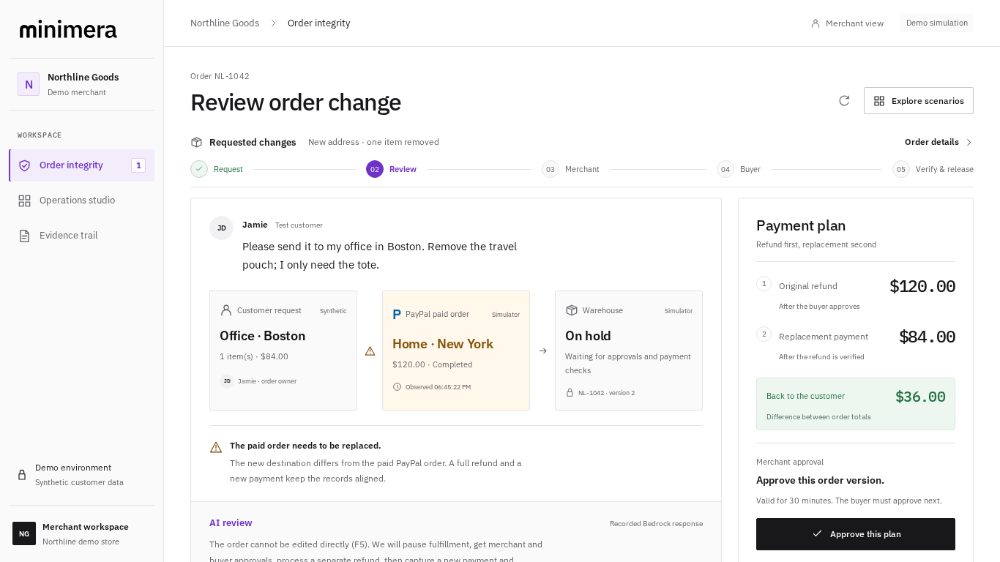
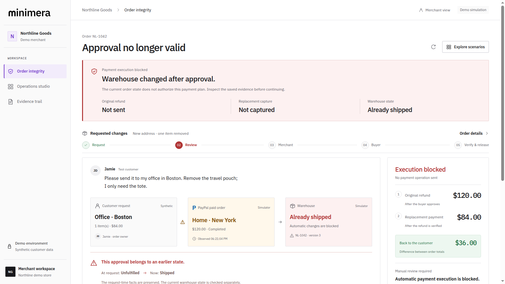

# Minimera Order Integrity

Keep changed PayPal orders consistent with approvals, verified payments and fulfillment.

[Live demo](https://minimera.onrender.com) · [Watch the 2:28 demo](https://www.youtube.com/watch?v=eMzSokgCYYE) · [Judge walkthrough](docs/JUDGING.md) · [Architecture](docs/ARCHITECTURE.md)

A customer has already paid, then asks to change the delivery address and remove an item. The request, original payment and warehouse order now disagree. Minimera holds fulfillment, explains the route using seven scoped facts, binds merchant approval to the exact order snapshot, obtains separate buyer approval and verifies the refund and replacement payment before preparing the corrected order for release.



## Try it

Open **[minimera.onrender.com](https://minimera.onrender.com)**. No account or keys are required. The hosted demo uses simulated payments, synthetic merchant/warehouse records and actual recorded Bedrock responses, with visible source labels. Render Free may take about a minute to wake after idle; synthetic state can reset on restart.

Start with **Test an outdated approval → Approve this plan → What if the warehouse ships now?** The earlier approval becomes unusable and no refund or replacement capture is dispatched. Then choose **Explore scenarios → A safe change** for the complete successful path, including the independent buyer session and evidence export.



## Run locally

Use Python 3.10+, Node.js 22.12+ and npm on Linux or WSL. From the repository root:

```bash
python3 -m venv .venv
.venv/bin/python -m pip install -r requirements.txt
npm ci --prefix ui --no-audit --no-fund
npm run build --prefix ui
.venv/bin/python scripts/serve_order_integrity.py
```

Open **http://127.0.0.1:8766**. Dependencies need internet during installation; default operation needs no provider credentials, model download or fresh API calls. The example changes a $120 order into an $84 replacement. The $36 is the difference between order totals, before fees and taxes.

## Integrations

- **PayPal Sandbox:** original/replacement orders, separate buyer approval, capture, full refund and independent read-back of both payment legs. An actual test sequence completed a $1.00 refund and a distinct $0.70 capture. [Provider setup and scope](docs/ORDER_INTEGRITY.md#paypal-sandbox).
- **Amazon Bedrock:** GPT-OSS 120B explains the route from seven scoped facts. Names, full addresses, messages, payment IDs and approval tokens are excluded. Default replay is labelled; fresh inference is an explicit local option. [AI boundary](docs/ORDER_INTEGRITY.md#ai-and-data-minimization).
- **AG Studio:** two custom React widgets, an event grid, theming, layout tools and a constrained Agent Framework analyst. Source builds use vendor evaluation mode unless the operator supplies a licence. [Studio setup](docs/ORDER_INTEGRITY.md#ag-studio-trial-licence).
- **Render:** Docker web hosting, canonical HTTPS origin and UI/storage readiness. [Deployment](docs/DEPLOYMENT.md).

AI explains the plan. Deterministic policy and separate merchant/buyer approvals govern payment execution. Refund and capture are separate, non-atomic operations; unknown outcomes keep fulfillment held for reconciliation.

## Container

```bash
docker build -t minimera:demo .
docker run --rm --name minimera-demo -p 127.0.0.1:10000:10000 minimera:demo
```

Open **http://127.0.0.1:10000**. Readiness is **/api/integrity/health**. The application runs as an unprivileged user. No provider credentials are required for the default image.

## Verify

```bash
.venv/bin/python -m pip install -r requirements-dev.txt
.venv/bin/python scripts/check.py
.venv/bin/python -m playwright install chromium
.venv/bin/python scripts/verify_judge_demo.py
```

The quality suite runs Ruff, strict mypy, 210 Python tests and 270 Python/Worker comparisons across preserved experiments. The browser verifier runs 50 assertions, including separate roles, stale approvals, cancellation, restart, evidence hashes, layout and automated accessibility. CI also builds and checks the container, audits dependencies and scans Git history. Ordinary checks make no live payment or model calls. [Verification scope](docs/QUALITY.md).

Keep heavy local jobs sequential. The browser verifier requires at least 1,800 MiB available RAM and stops if available memory falls below 750 MiB. Browser CI uses Ubuntu 24.04 for the pinned Playwright version.

## Code and limitations

FastAPI routes call an injected workflow service, pure policy, SQLite storage, payment gateway and AI reviewer. The React client rejects older revisions arriving after a newer saved state. [Architecture](docs/ARCHITECTURE.md) · [Engineering conventions](CONTRIBUTING.md) · [Security reporting](SECURITY.md).

Merchant and warehouse systems are synthetic. This is a prototype without production tenant identity or operational reconciliation. It does not guarantee Seller Protection, certify legal compliance or establish measured merchant savings. The recomputable event hash chain is local evidence, not external attestation or an immutable ledger. Fees and taxes are outside the calculation.

Original source and fixtures use [MIT](LICENSE). [Third-party terms](THIRD_PARTY.md), including AG Studio and bundled font licences, remain applicable. Historical Context Lab experiments and measured failures are retained separately for reproducibility; they are not merchant-accuracy claims for this workflow. [Historical evaluation guide](docs/CONTEXT_LAB.md).

Maintained by [Borys Tsyrulnikov](https://github.com/tsyrulb). For setup problems, open an issue with the failing command and a redacted error. Use the security policy for vulnerability reporting.
