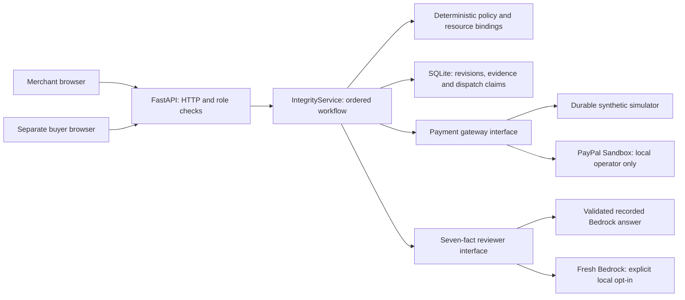

# Architecture and trust boundaries

Minimera Order Integrity handles a post-payment destination change with optional item removal. Its intended audience is merchant operations staff reviewing those changes before fulfillment.

## Code responsibilities

| Surface | Responsibility |
| --- | --- |
| `ntk/integrity/app.py` | Compose the application, settings and resource lifetime. |
| `api.py`, `auth.py`, `deployment.py` | HTTP validation, separate role capabilities and canonical origin. |
| `service.py` | Coordinate state transitions, approvals, independent payment observations and release. |
| `policy.py`, `contracts.py` | Deterministic decisions, exact resource bindings and validated domain records. |
| `payments.py`, `model.py` | Injected gateway/reviewer implementations; external calls and recording validation. |
| `store.py` | Private SQLite state, optimistic revisions, durable dispatch claims and per-app storage. |
| `ui/src/api.ts`, `useWorkspace.ts` | Typed transport errors and revision-aware client refresh. |
| `OrderScene.tsx`, `Outcome.tsx` | Current source comparison and outcomes derived from saved workflow state. |
| `Studio.tsx` | AG Studio custom widgets, event grid and constrained analyst intents. |

Classes own configuration, state or resource lifetime. Pure functions perform deterministic transformations. Structural `Gateway` and `Reviewer` interfaces provide the variations used by the app and tests. The current SQLite store remains concrete; there is no speculative storage framework.

## Payment sequence

1. Read the completed original payment and hold the synthetic fulfillment record.
2. Build the requested destination, item set and immutable review snapshot.
3. Obtain merchant approval of that exact snapshot, with a bounded expiry.
4. Obtain a separate buyer approval of the replacement amount and destination.
5. Dispatch the full original refund and independently read its identity, amount, currency, parent capture and status.
6. Only after the refund is verified, capture and independently verify the replacement payment.
7. Prepare a corrected fulfillment record. The merchant separately releases it after another binding check.

Refund and capture are separate, non-atomic operations. Unknown dispatch outcomes are retained for reconciliation; they are not treated as success or blindly retried. A warehouse change makes a prior approval unusable. Database revisions and committed operation claims protect the implemented single-process workflow.

## Model and data boundaries

The request contains seven scoped facts. Names, full addresses, customer messages, payment IDs, approval tokens and reference answers are outside that model context. The server still processes the order data needed for the workflow.

Bedrock explains the plan and cites facts. It cannot approve or dispatch a payment. Recorded answers retain the original model, prompt version, request hash and provider provenance; replay is visibly labelled. Free-form Studio input stays in the browser, and only three allowlisted question intents reach the server.

## Deployment and evidence limits

The hosted demo uses a simulator and recorded AI. Real Sandbox operations and fresh Bedrock require an explicit local configuration; no provider credentials enter the public service or CI. Merchant and warehouse systems are synthetic, and Render Free storage can reset on restart. This is a single-process prototype without production tenant identity, OMS/WMS integration or an operational reconciliation team.

The ordered hash chain can be independently recomputed from an export. It is local review evidence, not an external attestation or immutable ledger. Claims of measured business savings, legal compliance or guaranteed Seller Protection are outside the demonstrated result.

Historical Context Lab modules, synthetic evaluations and recorded outputs remain in the repository for reproducibility. They are separate from the current Order Integrity application. See [engineering conventions](../CONTRIBUTING.md), [judging instructions](JUDGING.md), [deployment](DEPLOYMENT.md) and [third-party terms](../THIRD_PARTY.md).
